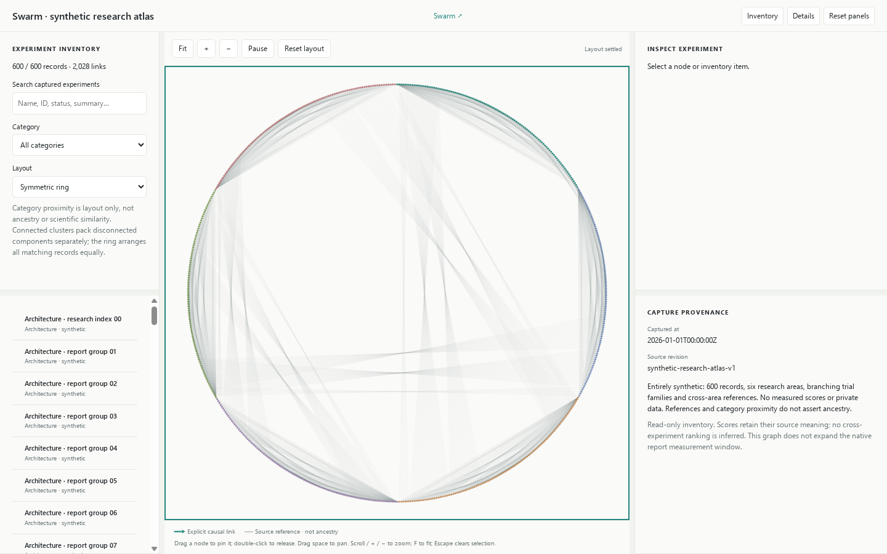

# Autoresearch Swarm

Run a bounded search over prompts, programs or training recipes. A Python
coordinator fills worker slots, records each attempt in SQLite and selects
candidates using the campaign's metric. A panel policy measures whether a
search improvement holds on independent examples.

Inspired by [Andrej Karpathy's autoresearch](https://github.com/karpathy/autoresearch).
The implementation is original and MIT-licensed.

## Start locally

From a source checkout with uv and Python 3.11 or newer, run the program
campaign on CPU.

~~~sh
uv sync --locked --group dev
uv run --no-sync python -m research_swarm swarm run benchmarks/program.yaml --db .research/program.sqlite
~~~

The campaign calibrates its scorer, evaluates three recipes and reports its
selected trial. Repeat the command to resume from the same queue.

[Run a campaign](docs/run-a-campaign.md) · [Operator guide](docs/operator-guide.md) · [Design](docs/design.md)

## Benchmarks

| Workload | Measurement |
| --- | --- |
| Program optimization | Fraction of fixed unit tests passed |
| MLP sweep | Classification accuracy on held-out synthetic points |
| Causal language model | Next-token validation loss after a training-code edit |

Each workload has random and greedy baselines at the same trial budget.
Run the training tasks on CPU or MPS with the small profile. The full
profile supports a configured CUDA device. Program and training-code
proposers can call local Ollama.

[Benchmark commands and comparison protocol](benchmarks/README.md)

## Project and operator references

| Task | Reference |
| --- | --- |
| Write a campaign and interpret selection | [Run a campaign](docs/run-a-campaign.md) |
| Inspect attempts, budgets and panel exposures | [Operator guide](docs/operator-guide.md) |
| Extend a proposer, backend or evaluator | [Swarm design](docs/design.md) |
| Adopt a manifest-based research project | [Project adoption](docs/project-adoption.md) · [Manifest](docs/project-manifests.md) · [Workload protocol](docs/workload-protocol.md) |
| Configure a native training environment | [Engine profiles](docs/engines.md) · [MLX workload](docs/mlx-workload.md) |
| Inspect controller records | [HTTP API](docs/api.md) · [Qualification history](docs/implementation.md) |
| Publish a release | [Release guide](docs/releasing.md) |

## Explore recorded experiments

The controller campaign workspace displays score history, lineage and
activity. The experiment inventory lays out explicit parent links and
supports pan, zoom and pinning. The example below contains 600 synthetic
records across six research areas.

[Campaign workspace](docs/campaign-view.md) · [Experiment inventory](docs/experiment-graph.md) · [Generate the sample](examples/graph_inventory)

## Development

~~~sh
uv run ruff check .
uv run ruff format --check .
uv run mypy src
uv run pytest
~~~

[Contributing](CONTRIBUTING.md)
